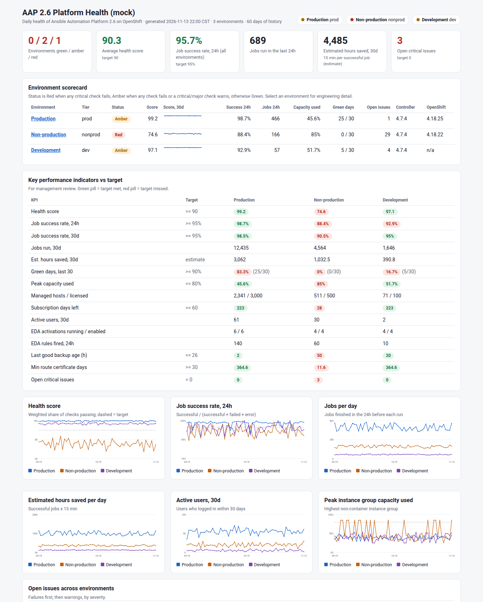
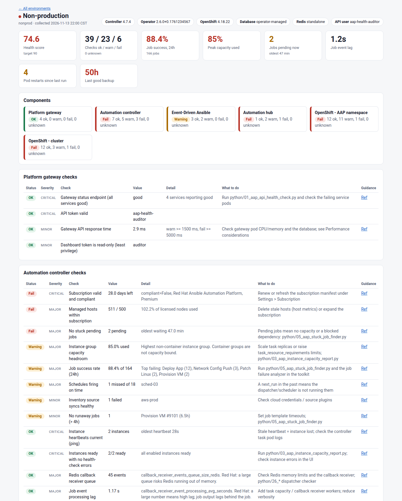

# AAP 2.6 Health Dashboard (OpenShift operator)

A daily health check and trend dashboard for Red Hat Ansible Automation Platform 2.6 installed with
the operator on OpenShift Container Platform, across multiple environments. It runs from GitHub
Actions (or cron) at end of day, scores each environment, keeps history, and publishes a static site
to GitHub Pages.

- **Managers:** fleet status (Green/Amber/Red), health score, KPIs against targets, job success,
  volume and estimated hours saved, subscription, backups, certificates, 90-day trend charts.
- **Platform engineers / support:** about 70 checks across platform gateway, automation controller,
  Event-Driven Ansible, automation hub, the AAP namespace and the OpenShift cluster, each with value,
  detail, remediation hint, troubleshooting-toolkit reference and a link to the Red Hat guidance it
  implements. 15 per-environment trend charts, detail tables and CSV/JSON exports.
- **Read-only by design:** HTTP GET only, bearer tokens only. A read-scoped AAP token for a Platform
  Auditor user and an OpenShift ServiceAccount with get/list/watch roles are all it needs.
- **No dependencies:** single Python file, standard library only (Python 3.9+). Pages have no
  JavaScript and no CDN, so they work on air-gapped or private Pages.





```
aap_health_dashboard.py               the collector + site generator
environments.example.json             config template (URLs and secret names only)
.github/workflows/aap-health-dashboard.yml   daily run + publish to gh-pages
deploy/openshift/rbac.yaml            read-only ServiceAccount, roles and token
deploy/cron/aap-health-dashboard.cron alternative: cron on a Linux host
docs/CHECKS.md  docs/KPIS.md  docs/RBAC.md  docs/RUNBOOK.md
tests/                                mock AAP + OpenShift + Prometheus, 60-day end-to-end test
```

## Quick start (local)

```bash
cp environments.example.json environments.json      # edit URLs, namespaces, secret names
export AAP_TOKEN_PROD=...  OCP_TOKEN_PROD=...        # read-only tokens, see docs/RBAC.md
python3 aap_health_dashboard.py -c environments.json -o site --serve 8080
```

Run it again on later days (or let the schedule do it) and the trend charts fill in from
`site/history.json`.

## Read-only tokens

| System | Identity | Permission |
|---|---|---|
| AAP (gateway, controller, EDA, hub) | Dedicated user, e.g. `svc-aap-health` | Platform Auditor role, OAuth token with scope **Read** |
| OpenShift API | ServiceAccount `aap-health-reader` | get/list/watch on AAP namespace objects and selected cluster objects (no Secrets, no exec) |
| Prometheus (Thanos querier) | Same ServiceAccount | built-in `cluster-monitoring-view` |

`oc apply -f deploy/openshift/rbac.yaml` creates the ServiceAccount, roles and a token Secret.
The dashboard warns (`gateway.least_privilege`) if the AAP token belongs to a superuser. Full
endpoint and permission matrix: [docs/RBAC.md](docs/RBAC.md).

## GitHub Actions + Pages

1. Create a repository (or folder in an existing one) with these files and commit an
   `environments.json` (no secrets), or store it in the repository variable
   `AAP_HEALTH_CONFIG_JSON`.
2. Add repository secrets named exactly as each environment's `aap_token_env` / `ocp_token_env` /
   `prometheus_token_env` (for example `AAP_TOKEN_PROD`, `OCP_TOKEN_PROD`).
3. Register a **self-hosted runner** with network access to the AAP routes and OpenShift API, labeled
   `self-hosted, linux, aap-health` (override with variable `AAP_HEALTH_RUNS_ON`, a JSON list).
   GitHub-hosted runners only work when the clusters are reachable from the internet.
4. Run the workflow once (Actions > AAP health dashboard > Run workflow). It creates `gh-pages`.
5. Settings > Pages > Deploy from a branch > `gh-pages` / root.

The schedule is `0 4 * * *` UTC, which is 22:00 CST / 23:00 CDT, so each run lands on the same
Central-time business day (`report_tz` in the config). The workflow publishes even when one
environment is partially unreachable (exit 1), fails only when nothing could be collected (exit 2),
and optionally goes red with `fail_on` (exit 3).

**Visibility:** Pages from a public repository are public. For "anyone in the company", use a
private repository with GitHub Enterprise Cloud private Pages (access limited to org members), or
run on an internal web server with the cron option. Scheduled runs use `--redact` by default
(variable `AAP_HEALTH_REDACT=false` to turn it off), which masks hostnames, URLs and IP addresses.

## Cron alternative

See `deploy/cron/aap-health-dashboard.cron`: runs at 23:00 America/Chicago and writes into a web
root that any web server can serve. Keep tokens in a `0600` env file owned by the service user.

## Configuration reference

Global keys: `dashboard_title`, `report_tz`, `kpi_targets`, `thresholds`, `settings`
(`minutes_saved_per_job`, `cluster_checks`, `check_route_certs`, `excluded_alerts`, ...), `redact`.

Per environment: `name`, `label`, `tier`, `aap_url`, `aap_token_env`, `ocp_api_url`,
`ocp_token_env`, `prometheus_url`, `prometheus_token_env`, `namespace`, `aap_cr_name`,
`operator_namespace`, `verify_tls`, `ca_bundle`, `ocp_verify_tls`, `ocp_ca_bundle`, `timeout`,
`controller_prefix`, `eda_prefix`, `hub_prefix`, `gateway_prefix`, `eda_enabled`, `hub_enabled`,
`check_route_certs`, `route_tls_port`, `cluster_checks`, `minutes_saved_per_job`, `thresholds`.

## Command line

```
-c/--config FILE     config (default environments.json)
-o/--out DIR         output directory = Pages root (default site); history is read from here
-e/--env NAME        only these environments (repeatable)
--redact             mask hostnames/URLs/IPs in all published output
--no-cluster         skip cluster-scope OpenShift checks
--fail-on fail|warn  exit 3 when an environment is Red (fail) or Amber or worse (warn)
--chart-days N       days on trend charts (default 90); --keep-days N history retention (400)
--workers N          environments collected in parallel (default 4)
--as-of YYYY-MM-DD   label the run with a date (backfill / tests)
--serve PORT         serve the output after writing it
-q                   quiet
```

Exit codes: 0 all collected, 1 partial, 2 nothing collected or bad config, 3 `--fail-on` tripped.

## Testing

```bash
bash tests/make_certs.sh                       # self-signed certs for the mock (needs openssl)
python3 tests/seed_history.py --days 60 --out /tmp/ahs   # 60 simulated days, 3 environments
python3 -m http.server -d /tmp/ahs 8080
```

The mock serves AAP, OpenShift and Prometheus APIs for a healthy prod, a degraded nonprod and a dev
environment without cluster-reader, Prometheus or hub, and with a superuser token. It rejects every
non-GET request with 405, so the test also proves the read-only guarantee. The seed script asserts
statuses, expected check IDs, the least-privilege warning, the route TLS and backup warnings, output
files and redaction (`--redact`).

## References

Checks follow Red Hat guidance; each check links its source in the page and in
[docs/CHECKS.md](docs/CHECKS.md). Key documents:
[AAP 2.6 monitoring](https://docs.redhat.com/en/documentation/red_hat_ansible_automation_platform/2.6/observe-ensure_system_health_and_efficiency_through_monitoring),
[controller metrics](https://docs.redhat.com/en/documentation/red_hat_ansible_automation_platform/2.6/observe-assembly_controller_metrics),
[performance considerations for operator environments](https://docs.redhat.com/en/documentation/red_hat_ansible_automation_platform/2.6/html-single/performance_considerations_for_operator_environments/index),
[operator growth topology](https://docs.redhat.com/en/documentation/red_hat_ansible_automation_platform/2.6/plan-ref_ocp_a_env_a),
[AAP backup](https://docs.redhat.com/en/documentation/red_hat_ansible_automation_platform/2.6/administer-assembly_aap_backup),
[OpenShift cluster health checks](https://access.redhat.com/solutions/7004992),
[etcd recommended practices](https://docs.redhat.com/en/documentation/openshift_container_platform/4.18/html/scalability_and_performance/recommended-performance-and-scalability-practices-2).
