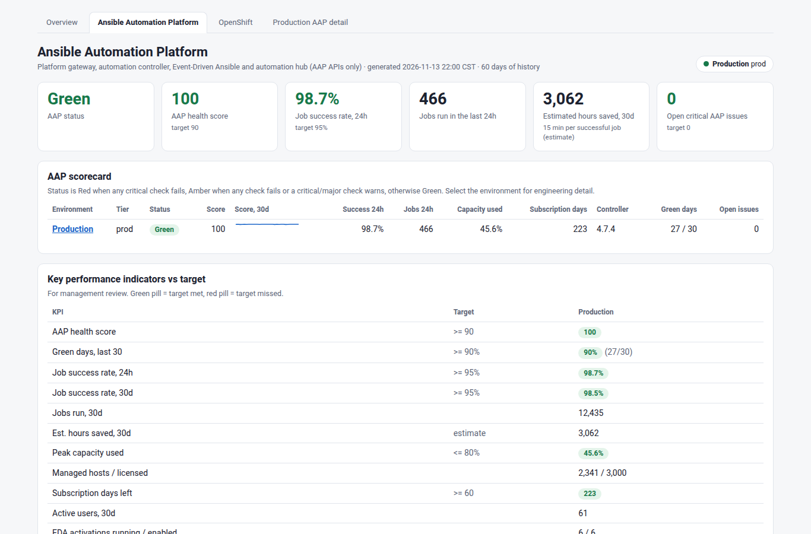
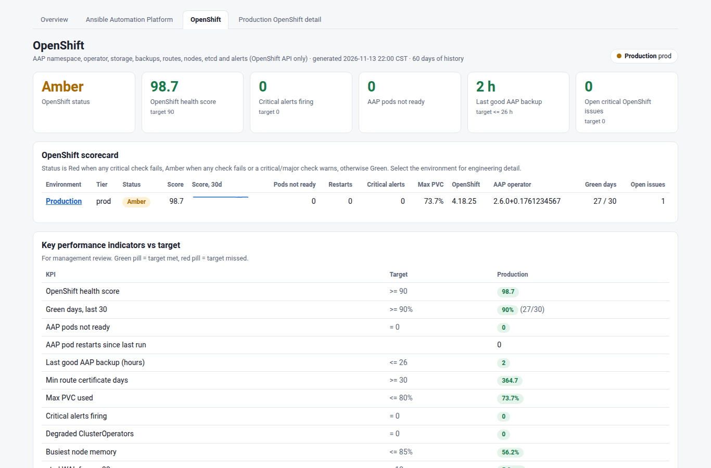

# AAP 2.6 Health Dashboard (OpenShift operator)

Daily health check and trend dashboards for Red Hat Ansible Automation Platform 2.6 installed with
the operator on OpenShift Container Platform. Two independent Python scripts run from GitHub Actions
(or cron) at end of day, score Production, keep history and publish one static site to GitHub Pages
with the AAP and OpenShift data on separate pages.

| Script | Data source | Token | Publishes |
|---|---|---|---|
| `aap_health_dashboard.py` | AAP APIs only: platform gateway, automation controller, Event-Driven Ansible, automation hub | AAP OAuth token, scope read, Platform Auditor | `site/aap/` |
| `ocp_health_dashboard.py` | OpenShift API and cluster monitoring only: AAP namespace, operator, storage, backups, routes, nodes, etcd, alerts | `aap-health-reader` ServiceAccount (get/list/watch) | `site/openshift/` |

Both scripts refresh `site/index.html`, a landing page with one panel per dashboard. Each script has
its own health score, Green/Amber/Red status, `history.json`, KPIs and trend charts, so an OpenShift
problem never lowers the AAP score and the other way round. Either can run alone.

- **Managers:** `aap/index.html` (job success, volume, estimated hours saved, capacity, subscription,
  users, EDA, hub) and `openshift/index.html` (pods, restarts, backups, certificates, storage, alerts,
  ClusterOperators, node headroom, etcd), each with KPIs against targets and 90-day trends.
- **Platform engineers / support:** per-environment pages under `aap/env/` and `openshift/env/` with
  every check, value, detail, remediation hint, Red Hat reference link, trend charts and tables, plus
  CSV/JSON exports.
- **Production only:** `settings.only_tiers: ["prod"]` plus `"enabled": false` on other environments.
  `--env NAME` overrides both for ad-hoc runs.
- **Read-only by design:** HTTP GET only, bearer tokens only (see [docs/RBAC.md](docs/RBAC.md)).
- **No dependencies:** Python 3.9+ standard library. Pages have no JavaScript and no CDN.






```
aap_health_dashboard.py               AAP collector + aap/ pages
ocp_health_dashboard.py               OpenShift collector + openshift/ pages
healthdash_core.py                    shared: read-only HTTP client, scoring, history, HTML renderer, CLI
environments.example.json             config template (URLs and secret names only; Production enabled)
.github/workflows/aap-health-dashboard.yml   daily run of both scripts + publish to gh-pages
deploy/openshift/rbac.yaml            read-only ServiceAccount, roles and token (OpenShift script)
deploy/cron/aap-health-dashboard.cron alternative: cron on a Linux host (both scripts)
docs/CHECKS.md  docs/KPIS.md  docs/RBAC.md  docs/RUNBOOK.md
tests/                                mock AAP + OpenShift + Prometheus, 60-day end-to-end test
```

## Site layout

```
site/index.html                       landing: AAP panel + OpenShift panel
site/aap/index.html                   AAP management view
site/aap/env/prod.html                AAP engineering detail
site/aap/history.json  site/aap/data/{latest.json,checks_latest.csv,snapshots/}
site/openshift/index.html             OpenShift management view
site/openshift/env/prod.html          OpenShift engineering detail
site/openshift/history.json  site/openshift/data/{latest.json,checks_latest.csv,snapshots/}
```

## Quick start (local)

```bash
cp environments.example.json environments.json      # edit URLs, namespaces, secret names
export AAP_TOKEN_PROD=...                            # AAP read token (Platform Auditor)
python3 aap_health_dashboard.py -c environments.json -o site
export OCP_TOKEN_PROD=...                            # aap-health-reader ServiceAccount token
python3 ocp_health_dashboard.py -c environments.json -o site --serve 8080
```

Run them again on later days (or let the schedule do it) and the trend charts fill in from
`site/aap/history.json` and `site/openshift/history.json`.

## Read-only tokens

| System | Identity | Permission |
|---|---|---|
| AAP (gateway, controller, EDA, hub) | Dedicated user, e.g. `svc-aap-health` | Platform Auditor role, OAuth token with scope **Read** |
| OpenShift API | ServiceAccount `aap-health-reader` | get/list/watch on AAP namespace objects and selected cluster objects (no Secrets, no exec) |
| Prometheus (Thanos querier) | Same ServiceAccount | built-in `cluster-monitoring-view` |

`oc apply -f deploy/openshift/rbac.yaml` creates the ServiceAccount, roles and a token Secret.
`aap_health_dashboard.py` only reads the AAP token and `ocp_health_dashboard.py` only reads the
OpenShift token. The AAP dashboard warns (`gateway.least_privilege`) if the AAP token belongs to a superuser. Full
endpoint and permission matrix: [docs/RBAC.md](docs/RBAC.md).

## GitHub Actions + Pages

1. Create a repository (or folder in an existing one) with these files and commit an
   `environments.json` (no secrets), or store it in the repository variable
   `AAP_HEALTH_CONFIG_JSON`.
2. Add repository secrets named exactly as each environment's `aap_token_env` / `ocp_token_env` /
   `prometheus_token_env` (for example `AAP_TOKEN_PROD`, `OCP_TOKEN_PROD`).
3. Register a **self-hosted runner** with network access to the AAP routes and OpenShift API, labeled
   `self-hosted, linux, aap-health` (override with variable `AAP_HEALTH_RUNS_ON`, a JSON list).
   GitHub-hosted runners only work when the clusters are reachable from the internet.
4. Run the workflow once (Actions > AAP health dashboard > Run workflow). It runs both scripts and
   creates `gh-pages`.
5. Settings > Pages > Deploy from a branch > `gh-pages` / root.

The schedule is `0 4 * * *` UTC, which is 22:00 CST / 23:00 CDT, so each run lands on the same
Central-time business day (`report_tz` in the config). Each script reports its own exit code. The
workflow publishes when a script is partial (exit 1), keeps the previous pages for a script that
collected nothing (exit 2) and fails only when both return 2; `fail_on` turns the run red (exit 3).

**Visibility:** Pages from a public repository are public. For "anyone in the company", use a
private repository with GitHub Enterprise Cloud private Pages (access limited to org members), or
run on an internal web server with the cron option. Scheduled runs use `--redact` by default
(variable `AAP_HEALTH_REDACT=false` to turn it off), which masks hostnames, URLs and IP addresses.

## Cron alternative

See `deploy/cron/aap-health-dashboard.cron`: runs the AAP script at 23:00 and the OpenShift script
at 23:05 America/Chicago, both writing into one web root that any web server can serve. Keep tokens in a `0600` env file owned by the service user.

## Configuration reference

Global keys: `dashboard_title`, `report_tz`, `kpi_targets`, `thresholds`, `settings`
(`only_tiers`, `minutes_saved_per_job`, `cluster_checks`, `check_route_certs`, `excluded_alerts`,
...), `redact`.

Per environment: `name`, `label`, `tier`, `enabled`, `database` (`operator-managed` or `external`,
AAP script), `aap_url`, `aap_token_env`, `ocp_api_url`,
`ocp_token_env`, `prometheus_url`, `prometheus_token_env`, `namespace`, `aap_cr_name`,
`operator_namespace`, `verify_tls`, `ca_bundle`, `ocp_verify_tls`, `ocp_ca_bundle`, `timeout`,
`controller_prefix`, `eda_prefix`, `hub_prefix`, `gateway_prefix`, `eda_enabled`, `hub_enabled`,
`check_route_certs`, `route_tls_port`, `cluster_checks`, `minutes_saved_per_job`, `thresholds`.

## Command line

```
-c/--config FILE     config (default environments.json)
Both scripts take the same options (--no-cluster is OpenShift only):

-o/--out DIR         site root = Pages root (default site); each script writes its own subfolder
-e/--env NAME        only these environments (repeatable)
--redact             mask hostnames/URLs/IPs in all published output
--no-cluster         ocp_health_dashboard.py: skip cluster-scope checks
--fail-on fail|warn  exit 3 when an environment is Red (fail) or Amber or worse (warn)
--chart-days N       days on trend charts (default 90); --keep-days N history retention (400)
--workers N          environments collected in parallel (default 4)
--as-of YYYY-MM-DD   label the run with a date (backfill / tests)
--serve PORT         serve the output after writing it
-q                   quiet
```

Exit codes: 0 all collected, 1 partial, 2 nothing collected or bad config, 3 `--fail-on` tripped.

## Testing

```bash
bash tests/make_certs.sh                       # self-signed certs for the mock (needs openssl)
python3 tests/seed_history.py --days 60 --out /tmp/ahs   # 60 simulated days, both scripts, Production only
python3 tests/seed_history.py --days 30 --out /tmp/ahs-all --all-envs --redact   # all 3 mock environments
python3 -m http.server -d /tmp/ahs 8080
```

The mock serves AAP, OpenShift and Prometheus APIs for a healthy prod, a degraded nonprod and a dev
environment without cluster-reader, Prometheus or hub, and with a superuser token. It rejects every
non-GET request with 405, so the test also proves the read-only guarantee. The seed script runs both scripts for each day and asserts
that neither produces the other's checks, that the AAP and OpenShift pages contain only their own
content, that only Production is checked by default, statuses, expected check IDs, the least-privilege warning, the route TLS and backup warnings, output
files and redaction (`--redact`).

## References

Checks follow Red Hat guidance; each check links its source in the page and in
[docs/CHECKS.md](docs/CHECKS.md). Key documents:
[AAP 2.6 monitoring](https://docs.redhat.com/en/documentation/red_hat_ansible_automation_platform/2.6/observe-ensure_system_health_and_efficiency_through_monitoring),
[controller metrics](https://docs.redhat.com/en/documentation/red_hat_ansible_automation_platform/2.6/observe-assembly_controller_metrics),
[performance considerations for operator environments](https://docs.redhat.com/en/documentation/red_hat_ansible_automation_platform/2.6/html-single/performance_considerations_for_operator_environments/index),
[operator growth topology](https://docs.redhat.com/en/documentation/red_hat_ansible_automation_platform/2.6/plan-ref_ocp_a_env_a),
[AAP backup](https://docs.redhat.com/en/documentation/red_hat_ansible_automation_platform/2.6/administer-assembly_aap_backup),
[OpenShift cluster health checks](https://access.redhat.com/solutions/7004992),
[etcd recommended practices](https://docs.redhat.com/en/documentation/openshift_container_platform/4.18/html/scalability_and_performance/recommended-performance-and-scalability-practices-2).
